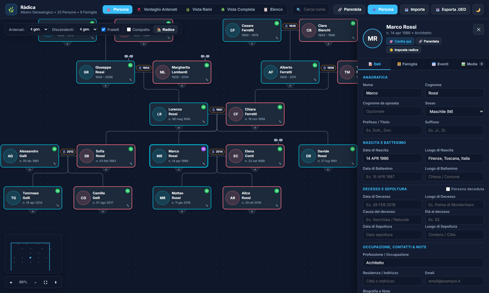
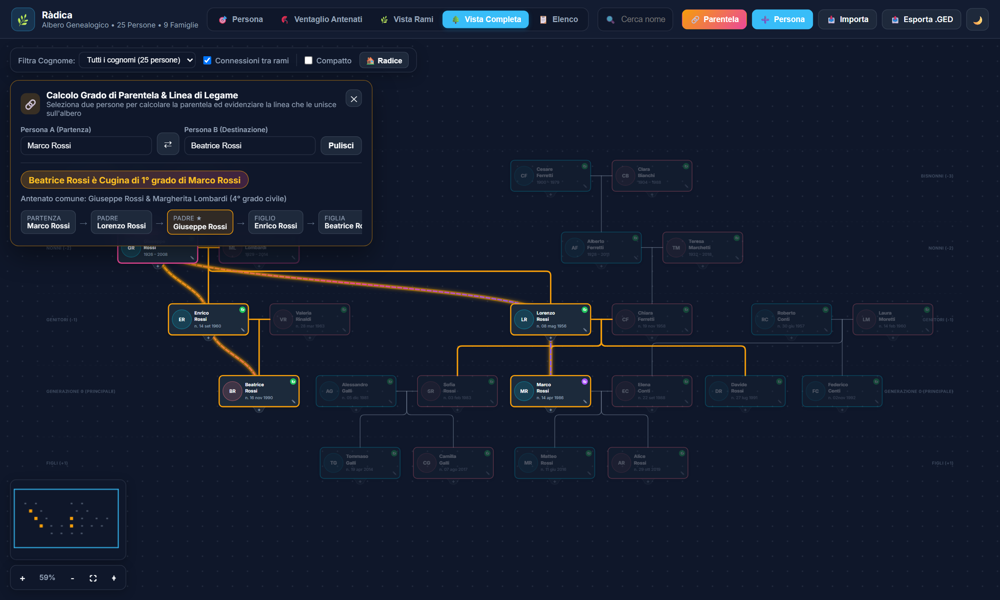
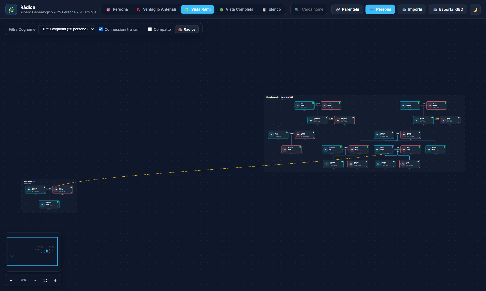
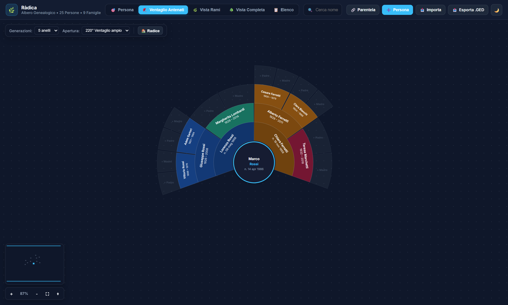

# 🌿 Ràdica — Self-Hosted Family Tree Viewer & GEDCOM Editor

**Ràdica** è un'applicazione web self-hosted leggera, moderna e veloce per esplorare, modificare e gestire alberi genealogici in formato **GEDCOM 5.5.1** (compatibile con MyHeritage, Ancestry, Gramps, FamilySearch, ecc.).

---

## 📸 Anteprima

### 🎯 Vista Persona (Clessidra) & Scheda Anagrafica


### 🌳 Vista Completa Unificata & Calcolatore di Parentela


### 🌿 Vista Rami (con connessioni interattive tra rami familiari)


### 🪭 Ventaglio degli Antenati (Fan Chart)


---

## ✨ Caratteristiche Principali

- **5 Modalità di Visualizzazione Interattive** (con Pan/Zoom fluido e Minimappa):
  - 🎯 **Vista Persona (Clessidra):** concentrata su un individuo scelto, con genitori accoppiati sopra i figli, fratelli con coniugi/figli, indicatore di rami nascosti espandibili e discendenti sotto.
  - 🪭 **Ventaglio degli Antenati (Fan Chart):** grafico ad anelli concentrici (da 3 a 7 generazioni, apertura `180°`, `220°` o `360°`) colorato per ramo familiare.
  - 🌿 **Vista Rami:** suddivide l'albero per capostipiti/rami familiari con collegamenti curvi interattivi che evidenziano i matrimoni tra rami diversi.
  - 🌳 **Vista Completa Unificata:** l'intero albero genealogico disposto dall'alto in basso su fasce generazionali cronologiche con incastro automatico dei rami acquisiti (*Contour-Packed Pocket Docking*) e instradamento multi-corsia senza linee sovrapposte.
  - 📋 **Vista Elenco / Tabella:** elenco anagrafico completo ricercabile, filtrabile (sesso, viventi/deceduti, con/senza foto) e ordinabile.
- 🔗 **Calcolatore del Grado di Parentela & Linea Luminosa:**
  - Calcola il legame genealogico esatto in italiano tra due persone qualsiasi (sia di sangue tramite l'Antenato Comune più vicino *MRCA*, sia acquisito tramite matrimonio).
  - Evidenzia sull'albero con una **linea luminosa animata** tutti i passaggi che legano la Persona A alla Persona B.
- 📝 **Editor Completo & Media Locali:**
  - Modifica dati anagrafici, date, luoghi, occupazione, contatti, biografia/note ed eventi della vita.
  - Aggiunta, collegamento e rimozione rapida di genitori, coniugi, figli e fratelli.
  - Caricamento di foto profilo e documenti PDF salvati localmente (più download automatico in locale delle foto remote presenti nei file GEDCOM).
- 📥/📤 **Importazione ed Esportazione GEDCOM 5.5.1 (`.ged`):**
  - Importa qualsiasi file `.ged` con backup automatico e riesporta l'albero aggiornato in standard GEDCOM 5.5.1 UTF-8.

---

## 📂 File GEDCOM d'Esempio Incluso

Nel repository è incluso un file GEDCOM dimostrativo con **25 persone fittizie distribuite su 4 generazioni** (`Rossi`, `Conti`, `Ferretti`, `Lombardi`, `Marchetti`, `Galli`, `Moretti`):

- [`examples/famiglia_rossi_esempio.ged`](examples/famiglia_rossi_esempio.ged)

Puoi caricarlo direttamente dall'interfaccia cliccando sul pulsante **📥 Importa** in alto a destra.

---

## 🚀 Avvio Rapido con Docker Compose

```bash
git clone https://github.com/Trifase/radica.git
cd radica
docker compose up -d --build
```

L'applicazione sarà disponibile su `http://localhost:4000`. Tutti i dati e i file multimediali personali vengono salvati nella cartella `./data` (ignorata da Git per proteggere la privacy).
